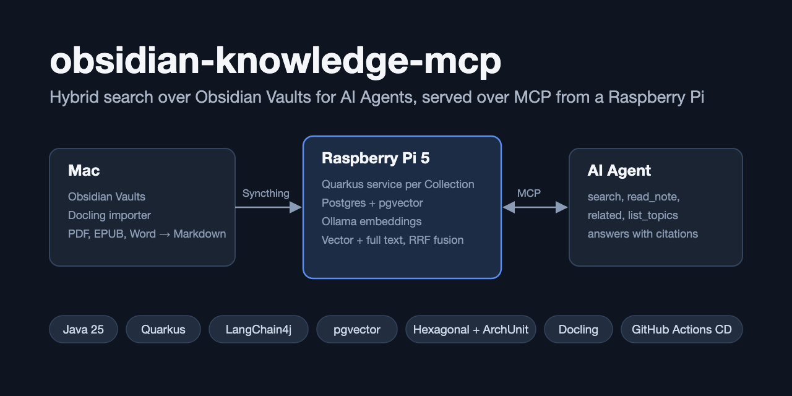
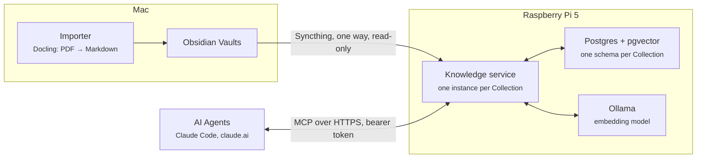

# obsidian-knowledge-mcp

[](https://github.com/Luca-Blum/obsidian-knowledge-mcp/actions/workflows/ci.yml)
[](https://github.com/Luca-Blum/obsidian-knowledge-mcp/actions/workflows/deploy.yml)
[](LICENSE)


A self-hosted retrieval service that turns Obsidian Vaults into isolated knowledge bases and lets an AI Agent search
them over MCP. Hybrid search (pgvector + Postgres full text), Java 25, Quarkus, LangChain4j. It runs on a Raspberry
Pi 5 and deploys there on every merge.



## Why

My notes and sources live in Obsidian: books converted from PDF, course material, my own notes linking them. I want an
AI Agent to answer questions from exactly these sources and cite them, without a cloud service, without usage
limits, and without the Vault ever leaving my control.

The service does **Agentic RAG**: it only retrieves. The AI Agent decides when to search, which Notes to read in
full and which Links to follow, and writes the answer itself. No language model runs on the Pi.

## Highlights

- **Hexagonal architecture, enforced.** Domain and use cases are plain Java; Quarkus, LangChain4j and Postgres appear
  only in adapters. Every type carries its role as a jMolecules annotation, and ArchUnit tests fail the build when a
  dependency points the wrong way ([ADR 0003](docs/adr/0003-ports-are-interfaces-and-roles-are-annotated.md),
  [ADR 0004](docs/adr/0004-packages-by-layer-then-concept.md)).
- **Hybrid search with a relevance cut-off that works.** Vector and full-text rankings are merged with Reciprocal
  Rank Fusion. Because fused scores carry no notion of relevance, the Minimum Similarity is applied to the vector list
  *before* the fusion ([ADR 0002](docs/adr/0002-minimum-similarity-before-fusion.md)).
- **Measured, not guessed.** Every Collection has an Evaluation Set of real questions and Negative Questions. Each
  change to search moves one lever and is measured against the baseline ([evaluation](docs/evaluation/README.md)).
- **Tools designed for AI Agents.** Separate parameters for semantic `query` and exact `keywords`, per-Collection
  tool descriptions, Search Hits capped per Note, and calibrated abstention: an off-topic question gets no hits
  instead of the least bad match.
- **A self-healing index.** Reconciliation compares content hashes with the Vault on start-up, periodically and after
  file changes, and embeds only what changed. A changed embedding model or chunking rule triggers a full Re-Index on
  its own, so swapping the model is a configuration change.
- **Isolated Collections.** One image, one instance per Collection, each with its own Postgres schema and database
  role, its own Vault mounted read-only, its own bearer tokens and its own public HTTPS origin.
- **Continuous deployment to a Raspberry Pi.** GitHub Actions tests and builds a native arm64 image; a self-hosted
  runner on the Pi pulls it and waits until every instance is healthy. The Pi opens no port.
- **Two languages, one system.** The Java service on the Pi and a Python importer on the Mac that converts PDFs,
  EPUBs, Word and a dozen other formats into Source Notes with [Docling](https://github.com/docling-project/docling).

## Results

Hit@5 on the Engineering Collection (16 questions, `bge-m3`): from **0.88** with plain vector search to **1.00**
with hybrid search, once the questions carry the exact terms the AI Agent passes as `keywords`.

| Configuration | Hit@5 | Recall@5 | MRR |
| --- | --- | --- | --- |
| Plain vector search ([baseline](docs/evaluation/engineering-baseline.md)) | 0.88 | 0.75 | 0.80 |
| Hybrid search, full-text weight 1.0, with `keywords` ([details](docs/evaluation/engineering-hybrid-search.md)) | 1.00 | 0.91 | 0.92 |

The same measurement also showed what hybrid search costs without `keywords`: the whole question as full-text query
pushes long book chapters into the top 5. That is why the `search` tool asks the AI Agent for exact terms separately.

## How it works



1. Notes are written on the Mac. The importer turns documents dropped into a Topic's `_inbox/` into Source Notes.
2. Syncthing mirrors each Vault one way to the Pi. Obsidian stays the only source of truth; the index can be
   deleted and rebuilt at any time.
3. Each instance parses its Vault's Markdown, cuts it into Chunks along headings, embeds them with Ollama and stores
   vectors, full text and Links in its own schema.
4. The AI Agent calls the MCP tools:

| Tool | What the AI Agent gets |
| --- | --- |
| `search` | Search Hits: the matching Chunks with Note path, heading path and Note Kind |
| `read_note` | A whole Note, or one section by its heading path |
| `related` | Links, Backlinks, and Links that resolve to nothing or to several Notes |
| `list_topics`, `list_sources` | What a Collection holds |

The full design, with its trade-offs, is in [`docs/architecture.md`](docs/architecture.md).

## Tech stack

| Area | Choice |
| --- | --- |
| Service | Java 25, Quarkus, Quarkus LangChain4j, `quarkus-mcp-server-http` (Streamable HTTP) |
| Architecture | Hexagonal, jMolecules, ArchUnit |
| Storage and search | Postgres 17, pgvector, `tsvector` full text with German and English stemming |
| Embeddings | Ollama, `bge-m3` (1024 dimensions, multilingual), replaceable through configuration |
| Importer | Python, uv, Docling, Lingua for language detection, launchd |
| Tests | JUnit, ArchUnit, Quarkus Dev Services with real Postgres and pgvector, pytest |
| Operations | Docker Compose, GitHub Actions, GHCR, self-hosted runner, Tailscale Funnel, Syncthing |

## Quickstart

You need Java 25, Docker and [Ollama](https://ollama.com). Quarkus Dev Services start Postgres with pgvector.

```shell
ollama pull bge-m3
COLLECTION_VAULT_PATH=/path/to/your/vault ./service/mvnw -f service/pom.xml quarkus:dev
claude mcp add --transport http knowledge http://localhost:8081/mcp --header "Authorization: Bearer dev-token"
```

The last line connects Claude Code; any MCP client that can send a header works. Configuration, tests and the
Re-Index are described in [`service/README.md`](service/README.md).

## Repository

| Folder | What it holds |
| --- | --- |
| [`service/`](service/README.md) | The Quarkus knowledge service |
| [`importer/`](importer/README.md) | The Python importer that runs on the Mac |
| [`deploy/`](deploy/README.md) | Docker Compose, Postgres isolation and the Raspberry Pi setup |
| [`docs/`](docs/architecture.md) | Architecture, ADRs, evaluation results, ideas |
| [`.github/workflows/`](.github/workflows) | CI on every pull request, deploy on every merge to `main` |

## Documentation

- [Architecture](docs/architecture.md): goals, components, flows, retrieval design and trade-offs
- [Architecture Decision Records](docs/adr/README.md)
- [Glossary](GLOSSARY.md): the domain language used in code, docs and tool descriptions
- [Evaluation](docs/evaluation/README.md): method and results
- [Deployment](deploy/README.md): Raspberry Pi setup, operations and troubleshooting
- [Agentic engineering workflow](docs/agentic-development.md): specs, context engineering, guardrails, review gate
- [Ideas](docs/ideas.md): what was deliberately not built yet, and when to look again

## Agentic engineering workflow

Built with coding agents in a spec-driven, human-in-the-loop workflow:

- **Spec-driven:** every change starts as an issue with acceptance criteria; only issues triaged `ready-for-agent`
  go to an agent, and plans are stress-tested before implementation.
- **Context engineering:** agent instructions, a ubiquitous-language glossary and ADRs are versioned with the code,
  and recurring review findings become rules there.
- **Skills over prompts:** TDD, domain modeling, plan grilling and two-axis code review (standards and spec) run as
  versioned procedures from [mattpocock/skills](https://github.com/mattpocock/skills).
- **Guardrails:** ArchUnit architecture rules, integration tests on real Postgres, an eval suite for retrieval
  quality, CI on every pull request and health-gated deployment.
- **Human review gate:** every change reaches `main` through a pull request I review.

Details and examples: [`docs/agentic-development.md`](docs/agentic-development.md).

## Roadmap

- Compare `bge-m3` with `Qwen3-Embedding-0.6B` on the Evaluation Sets.
- Calibrate the Minimum Similarity per Collection with its Negative Questions.
- A re-ranker on the top candidates, if the Pi has the headroom.

## License

[Apache License 2.0](LICENSE)
