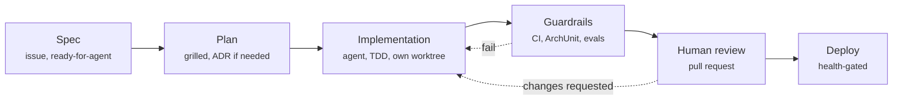

# Agentic Engineering Workflow

This project is built with coding agents in a spec-driven, human-in-the-loop workflow. I own the architecture, the
specs and the review gate; agents implement against them. What keeps the output reliable is not the prompt but the
system around the agent: versioned context, deterministic guardrails, evals and a merge gate that only a human
passes.

## Responsibilities

| Role | Owns |
| --- | --- |
| Engineer (me) | Problem framing, architecture, specs, decisions (ADRs), plan approval, code review, merge |
| Coding agent | Codebase exploration, plan proposals, implementation, tests, docs, pull request |
| Guardrails | Architecture conformance, test suite, retrieval quality, deployment health, all deterministic and on every change |

## Spec-driven development

Every change starts as a GitHub issue that serves as its spec: the problem, the expected behaviour and the acceptance
criteria, in the vocabulary of [`GLOSSARY.md`](../GLOSSARY.md). Triage labels gate what an agent may pick up: only
an issue labelled `ready-for-agent` is specified well enough to implement without guessing; `needs-info` and
`ready-for-human` keep underspecified or judgement-heavy work away from the agent. The label definitions live in
[`docs/agents/`](agents/), so agents apply them the same way.

Before implementation, the plan is stress-tested in a structured interview (*grilling*) until every open question is
resolved. A decision with lasting consequences is recorded as an [ADR](adr/README.md) before code depends on it.

## Context engineering

The agent's context is part of the codebase: versioned, reviewed and refined like code.

- [`CLAUDE.md`](../CLAUDE.md), the project's agent instructions: architecture rules (hexagonal, ports as
  interfaces, jMolecules roles), code style, test naming convention and wording rules.
- [`GLOSSARY.md`](../GLOSSARY.md), the ubiquitous language: each term with its definition and the synonyms to
  avoid, so names in code, tests, docs and MCP tool descriptions stay consistent across sessions and agents.
- [ADRs](adr/README.md) as durable decision memory, so an agent does not silently reopen a settled trade-off.
- [`docs/agents/`](agents/): the issue tracker, triage labels and how to consume the domain docs.

When a review uncovers a recurring mistake, the fix goes into this context rather than into a one-off prompt, so it
holds for every later session.

## Skills: repeatable procedures instead of ad-hoc prompts

Recurring tasks run as agent skills from [mattpocock/skills](https://github.com/mattpocock/skills), each a written,
versioned procedure:

| Skill | Used for |
| --- | --- |
| Grilling | Stress-testing a plan until it is unambiguous |
| Domain modeling | Maintaining the glossary and recording ADRs |
| Test-driven development | Red-green-refactor, integration tests against real Postgres |
| Code review | Reviewing a branch on two axes: conformance to the repository's standards, and to the issue's spec |
| Pull request | Writing a reviewer-oriented PR description with evidence and merge risk |

## Guardrails

Deterministic checks that hold no matter who or what wrote the code:

- **Architecture as code.** `ArchitectureTest` (ArchUnit + jMolecules) fails the build on a wrong dependency
  direction, a missing role annotation or a concrete class posing as a port.
- **Tests against real infrastructure.** Integration tests run on Postgres with pgvector through Quarkus Dev
  Services; only the embedding model is replaced by a deterministic fake.
- **Eval-driven retrieval.** Each Collection has an Evaluation Set with Negative Questions. Retrieval changes are
  measured on Hit@5, Recall@5 and MRR against a committed baseline, one lever at a time
  ([evaluation](evaluation/README.md)).
- **CI on every pull request** for the Java service and the Python importer.
- **Health-gated deployment.** The deploy fails when an instance is not healthy within ten minutes.

## Human in the loop

The merge is the gate. Every change reaches `main` through a pull request that I review: 33 merged so far, only the
initial setup was committed directly. Review covers what guardrails cannot: whether the design fits, whether names
carry the domain, and whether the change does what the spec meant rather than what it literally said.

Agents work in parallel in separate git worktrees, one issue each. Implementation scales out; review remains the
deliberate bottleneck.

## Decisions in practice

- **Discarding a working implementation.** An OAuth authorization server for claude.ai was built and fully tested
  (#52, PR #56, about 1,400 lines of security-critical code). Once claude.ai's custom connectors accepted static
  request headers, I validated that against a live Collection and closed the PR in favour of a static token per
  Client: less attack surface, no extra component.
  [ADR 0005](adr/0005-claude-ai-uses-a-static-token-not-oauth.md) records the trade-off.
- **Turning a review finding into a guardrail.** An early change satisfied the jMolecules rule by annotating the
  concrete use case classes as ports, which made the check pass while erasing the boundary it protects. The design
  was corrected ([ADR 0003](adr/0003-ports-are-interfaces-and-roles-are-annotated.md)), and the rule "never annotate
  a concrete class as a port to satisfy a rule; fix the design" went into `CLAUDE.md`.
- **Letting the eval decide.** Hybrid search at equal weights lowered Hit@5 when the full-text search received the
  whole question. Rather than tuning weights to the Evaluation Set, the MCP tool interface changed: the `search`
  tool now asks the AI Agent for exact terms as `keywords`. With them Hit@5 went from 0.88 to 1.00
  ([results](evaluation/README.md#results)).

## AI engineering in the product itself

The same discipline applies to what the service offers its own AI Agents:

- **Agentic RAG.** The service only retrieves; the AI Agent plans its own searches, reads and link traversal and
  writes the answer, so there is one LLM call instead of two and the agent sees the original sources.
- **Tool design for agents.** Tool descriptions are configured per Collection and tell the agent how to search well.
  `query` (semantic) and `keywords` (exact terms) are separate parameters, Search Hits are capped per Note with a
  count of what was left out, and an index being rebuilt answers with an error that states its progress instead of
  returning silently incomplete results.
- **Calibrated abstention.** A Minimum Similarity on the vector list lets a Collection return nothing for an
  off-topic question instead of its least bad match, so the agent can tell that it does not know
  ([ADR 0002](adr/0002-minimum-similarity-before-fusion.md)).