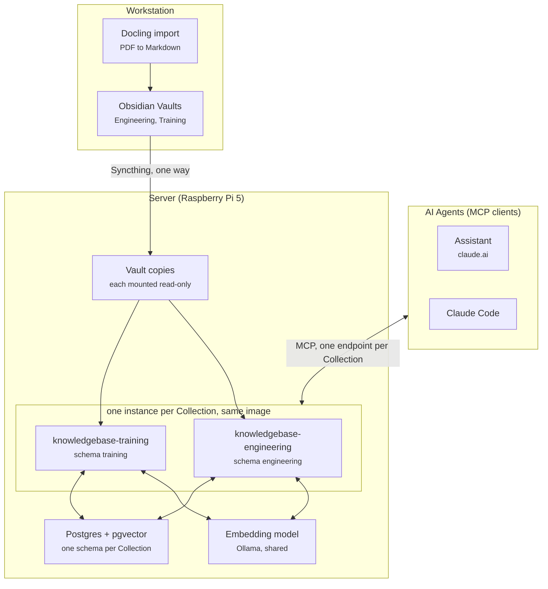
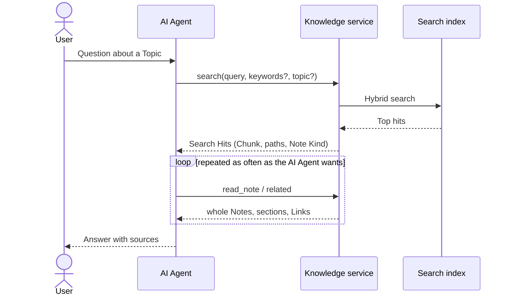
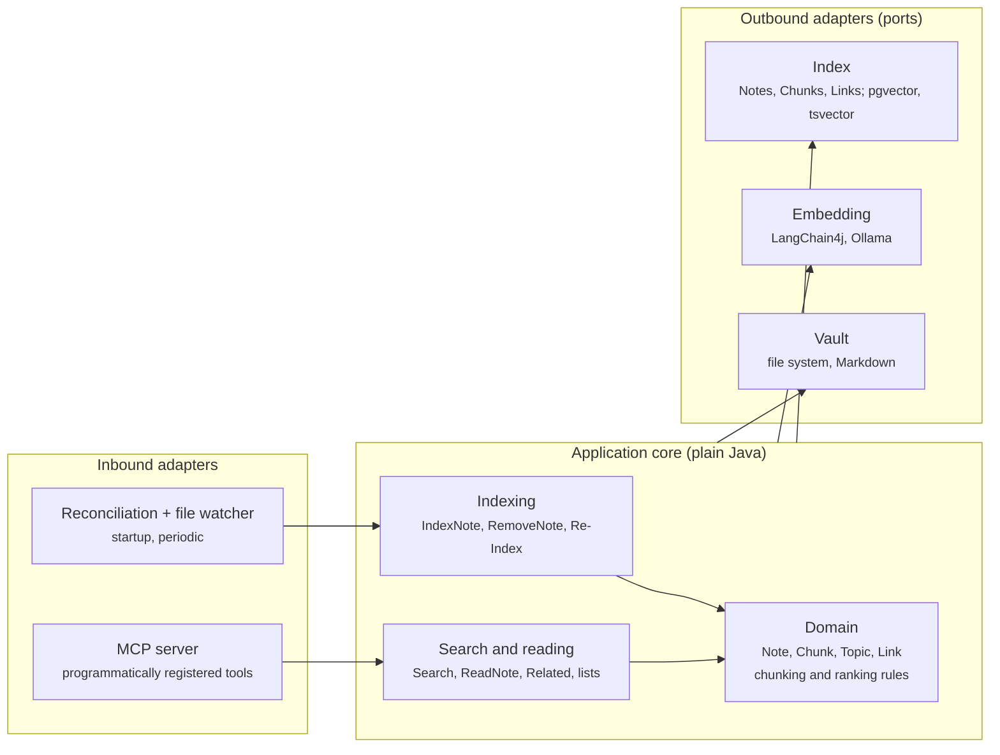

# Obsidian Knowledge Service – Architecture Overview

Terms are defined in [`GLOSSARY.md`](../GLOSSARY.md), and decisions with their reasoning are in [`docs/adr/`](adr/).

## Goal and Guiding Principles

A self-hosted knowledge service on a small home server lets an AI Agent, such as Claude Code or an assistant in claude.ai, ask questions about a subject area and get back the matching passages from a set of Obsidian Notes and sources. Unlike a hosted notebook service it has no usage limits, the sources never leave the owner's machines, and every part can be inspected and replaced.

1. **Obsidian is the only source of truth.** Notes, PDFs and links live in the Vaults on the workstation. Everything else is derived.
2. **The server is a pure read model.** It receives the Vaults one way and builds search indexes from them. Every index can be deleted and rebuilt at any time, and the server never writes to a Vault.
3. **Agentic RAG: retrieval on the server, generation by the AI Agent.** The service only returns facts (Chunks, Notes, Links). The AI Agent decides when and how often it searches, reads and answers. No language model runs on the server to write answers.
4. **Heavy work runs where the compute is.** PDF conversion with Docling runs on the workstation, not on the server.
5. **Models are replaceable.** The embedding model, and later a re-ranker, sit behind ports and are chosen only through configuration. A switch means changing the configuration, rebuilding the index and measuring against the Evaluation Set.
6. **Collections are isolated.** Each subject area is its own knowledge base with its own Vault, DB schema and service instance, and so its own MCP endpoint. A client sees only the Collections it has a connector for. Only infrastructure is shared (code, Postgres instance, Ollama). The isolation serves relevance and per-Collection configuration, not access control.

The reference deployment runs two Collections, `engineering` (software engineering sources) and `training` (sports science sources). They serve as the examples throughout this document; the code knows neither of them. The deployment runs on a Mac with Apple Silicon as the workstation and a Raspberry Pi 5 with 8 GB as the server.

## System Overview



The workstation is the master: Syncthing mirrors both Vaults one way to the server. There, a separate service instance per Collection indexes its Vault into its own schema. Over MCP it returns only Search Hits to the AI Agent, and the AI Agent writes the answer itself. Both instances share Postgres and Ollama.

## Components

| Component | Runs on | Responsibility | Writes to the Vault? |
| --- | --- | --- | --- |
| Obsidian | Workstation (master) | Write Notes, link sources, read PDFs | Yes (you) |
| Docling import | Workstation | PDF from `_inbox` → Markdown Source Note, move the PDF to `_sources` | Yes |
| Syncthing | Workstation (Send Only) → server (Receive Only) | Mirror both Vaults one way to the server, PDFs included as a backup | No (server copy only) |
| Quarkus knowledge service | Server | Watch the Vault, parse Markdown, chunk, embed, hybrid search, MCP server; one instance per Collection | No |
| Postgres + pgvector | Server | Chunks, vectors, full-text index, link graph, metadata | – |
| Embedding model | Server (Ollama, model replaceable through configuration) | Text → vector for Chunks and queries; multilingual (DE/EN) | – |
| Tailscale sidecar | Server, one per Collection | One HTTPS origin per Collection: public through Funnel for claude.ai, through the tailnet for Claude Code; the service checks a bearer token per Client | – |
| AI Agent (e.g. Claude Code, claude.ai) | Anthropic / workstation | Call tools, read sources, write the answer with citations | No |

So the server holds two things: a copy of all sources (the Vault, PDFs included) and the index derived from it. Only the Markdown files are indexed, and the PDFs sit next to them as originals.

## Vault Structure and Conventions

Each Collection has its own Vault. The rule: whatever should link to each other lives in the same Vault, because wikilinks don't work across Vault boundaries in Obsidian.

| Collection | Vault | Topics | Content |
| --- | --- | --- | --- |
| Engineering | `Engineering/` | e.g. Software-Engineering, Architecture | Technical books, articles and Own Notes |
| Training | `Training/` | e.g. Running, Cycling | Sports science sources and Own Notes |

Within a Vault, the first folder below the Vault root is the Topic, and deeper levels inherit it. The Topic comes only from the folder, never from the frontmatter, and serves as an optional filter within the Collection. Notes directly in the root are indexed but have no Topic, so a `topic` filter excludes them.

```
Engineering/                     ← Vault 1 → Collection "engineering"
├── Architecture/                ← a Topic
│   ├── _inbox/                  ← drop PDFs here (Docling picks them up)
│   ├── _sources/                ← original PDFs after conversion
│   └── Source-Notes/            ← Source Notes created by Docling (.md)
└── Software-Engineering/
    ├── _inbox/  _sources/  Source-Notes/
    └── *.md                     ← Own Notes, link to sources

Training/                        ← Vault 2 → Collection "training"
├── Running/
└── Cycling/                     ← each with _inbox/, _sources/, Source-Notes/, Own Notes
```

A Source Note gets frontmatter so that it can be linked and filtered:

```yaml
---
type: source
title: Clean Architecture – Chapter 5
lang: en
source: "[[_sources/clean-architecture-ch5.pdf]]"
imported: 2026-11-05
published: 2017          # optional, by hand: year, year-month or date
author: Robert C. Martin # optional, for citations
tags: [architecture, dependency-rule]
---
```

- **Note Kind:** `type: source` makes a Note a Source Note. Everything else, including a missing or custom `type`, makes it an Own Note. The `Source-Notes/` folder is only a filing convention. A Note there without `type: source` produces a warning but is not corrected.
- **Title:** `title`, else the file name without `.md`. The first H1 is never used.
- **Dates:** the importer sets `imported`, and `published` is optional. Missing fields stay empty, with no fallback to the file time. Invalid values produce a warning.
- **Language:** the importer detects `lang`, otherwise the Collection's default applies. Unknown values produce a warning.

Further rules:

- Own Notes link to Source Notes with wikilinks. The service reads these links as a graph (Links and Backlinks).
- Only `.md` files are indexed. Folders prefixed with `_` or `.` are skipped entirely at every level, whatever they contain: `.obsidian/`, `.trash/`, `_inbox/`, `_sources/`, `_eval/`, `_templates/`.
- A new Topic within a Collection is just a new folder. A new Collection is a new Vault plus one configuration entry (another service instance).

## Flows

### PDF Import (Workstation)

1. Drop the PDF into `<Topic>/_inbox/`.
2. The import script calls Docling and produces Markdown with headings and tables.
3. It writes the Source Note to `<Topic>/Source-Notes/` with `type`, `title`, `lang`, `imported` and `source` in the frontmatter (no `topic`) and moves the PDF to `<Topic>/_sources/`.
4. An existing Source Note is never overwritten. On a name clash, the new one gets a suffix.
5. If Docling fails, the PDF moves to `<Topic>/_inbox/_failed/` together with a log.
6. The author links the source from Own Notes.

If Docling returns Markdown without usable headings, the importer corrects nothing. The splitter's size limit catches that case.

### Sync and Indexing (Server)

1. Syncthing transfers changed files from the workstation to the server.
2. Each service instance compares its Vault with the index (Reconciliation): at startup and every N minutes it compares Note paths and content hashes and re-indexes only what differs. A file watcher speeds this up to seconds but is not the source of correctness. A rename is a delete plus a create.
3. It parses frontmatter, wikilinks and headings and cuts the Note into Chunks.
4. It computes the embeddings and, in one transaction, replaces all Chunks, the raw text and the Links of that Note.
5. Deleted Notes are removed from the index.

At startup the instance also compares the index fingerprint (embedding model, dimension, chunking parameters) with the configuration. If they differ, a full Re-Index starts automatically. Until it finishes, the Collection answers no searches and reports its progress (x/y Notes) through health and the MCP error text. The instance stays ready meanwhile, because reading and browsing still work and a Re-Index takes far longer than a deployment waits.

### A Question from an AI Agent



The AI Agent decides itself how often it searches and which Notes it reads in full. The service only returns text, and the answer comes from a single LLM call.

## Inside the Quarkus Service



The domain knows neither Quarkus nor Postgres.

The service follows a hexagonal architecture. The domain and use cases are plain Java, and Quarkus, LangChain4j and Postgres appear only in the adapters. ArchUnit tests guard the direction of dependencies, so that the embedding model or the vector store, for example, stay replaceable. Every type states its role with a jMolecules annotation (primary and secondary ports, application, adapters, value objects), and a use case is a primary port interface with an application class behind it; ADR 0003 has the rules.

The Collection is pure configuration (name, Vault path, DB schema, MCP port, tool description), and the same image runs once per Collection. The code never distinguishes between Engineering and Training. Each instance connects with its own DB role that sees only its schema.

### MCP Tools

| Tool | Parameters | Returns |
| --- | --- | --- |
| `search` | `query`, `keywords?`, `topic?`, `k` | Search Hits: Chunk content with Note path, heading path, Note Kind (`source`/`own`) and score. At most N hits per Note (configurable, e.g. 2), stating how many more Chunks of the Note would have matched. `keywords` drives the full-text search, and `query` is used when they are missing. Empty when no vector hit reaches the Minimum Similarity and the full-text search finds nothing |
| `read_note` | `path`, `heading?` | The Note from the index, frontmatter included; long Notes as an outline plus the beginning. `heading` is a heading path as in the Search Hit; an ambiguous path returns all matching sections |
| `related` | `path` | Separate categories: Links to Notes, Backlinks, Links to files, Unresolved and Ambiguous Links; heading anchors are kept |
| `list_sources` | `topic` | All Source Notes of a Topic with Title and date (`published`, else `imported`) |
| `list_topics` | – | Topics of this Collection with their number of Notes |

`path` is a key in the index (Vault-relative, NFC-normalized, matched exactly), not a file path. The query side has no file system access, path traversal is ruled out by construction, and search and reading see the same state. Links are stored as the text that was written and resolved only at query time, the way Obsidian does it ([ADR 0001](adr/0001-links-resolved-at-query-time.md)).

## Retrieval Quality

Search quality depends on four levers. Chunking and hybrid search usually help more than a bigger embedding model, because they fix whole classes of errors instead of only refining similarity.

### 1. Chunking: Our Own Markdown Splitter

The Markdown is read line by line in the domain (`domain.markdown`), which recognizes headings, code fences and tables without a parser library, and the splitter is domain logic:

- One Chunk per H2/H3 section (the level is configurable).
- Limits in characters, independent of the model (roughly 200 / 2000): merge smaller sections with their neighbour, split larger ones by paragraph, with a slight overlap. There is no tokenizer in the service, so comparing models changes only the model, not the Chunks. The upper limit, context prefix included, stays far below the input limit of every candidate model.
- Never cut in the middle of code blocks or tables. Such atomic blocks may exceed the upper limit.
- Clean up wikilinks for the embedding (`[[Clean Architecture|CA]]` → "CA"). The Link itself is stored as the written text.
- Don't embed the frontmatter, but store it as metadata (`tags`, Note Kind, Title, language). The raw text of the whole Note is stored for `read_note`.
- `ChunkId` = Note path plus a running number. It is unique even with duplicate headings and split sections, and deliberately not stable across changes. The unit of replacement is the Note. The heading path stays an attribute for embedding context and citations.
- Changed chunking parameters require a full Re-Index and are measured as an experiment of their own.

The most important lever is separating the embedding text from the display text: the text is embedded with a context prefix, and the AI Agent gets back only the content plus the path.

```java
public record Chunk(ChunkId id, NotePath note, HeadingPath headings, String content) {

    /** Text for the embedding: with context, so the vector knows what it is about. */
    public String embeddingText(Topic topic, NoteTitle title) {
        return "%s > %s > %s%n%n%s".formatted(topic, title, headings, content);
    }
}
```

### 2. Hybrid Search: Two Rankings, One Fusion

Vector search finds meaning, and full-text search finds exact terms (class names, abbreviations, proper names). The vector search uses `query` and works across languages. The full-text search uses `keywords` (else `query`) combined with AND and exists only for exact terms. Full-text hits pass unfiltered, and vector hits pass only above the Minimum Similarity. Both rankings are merged with Reciprocal Rank Fusion: each Chunk scores `weight / (k + rank)` summed over the lists it appears in (`HybridSearch` with `ReciprocalRankFusion`). The full-text list comes from one query that parses the terms once per Note Language in the Collection and compares each Chunk only with the terms of its own language:

```sql
WITH terms AS (
  SELECT language, plainto_tsquery(text_search_config(language), :terms) AS query
  FROM (SELECT DISTINCT language FROM note) languages
)
SELECT c.*, ts_rank_cd(c.full_text, t.query) AS score
FROM chunk c JOIN note n ON n.path = c.note_path JOIN terms t ON t.language = n.language
WHERE (:topic IS NULL OR n.topic = :topic) AND c.full_text @@ t.query
ORDER BY score DESC
LIMIT :candidates;
```

`full_text` is `chunk_full_text(language, title, heading_path, content)`: the Title weighted `A`, the heading path `B`, the body `D`.

| Lever | Effect |
| --- | --- |
| Candidates per list, final `k`, RRF `k` and list weights | Breadth of the search vs. noise; a full-text weight of 0 is plain vector search |
| Minimum Similarity (cosine, on the vector list before the fusion) | Below the threshold a vector hit doesn't count, which prevents off-topic answers. RRF only sets the order afterwards; a threshold on the RRF score would have no effect ([ADR 0002](adr/0002-minimum-similarity-before-fusion.md)). The value belongs to the model and is calibrated per Collection with Negative Questions |
| Hits per Note | Keeps one long Note from taking every slot |
| `setweight` on Title and headings | Hits in headings count more than in body text |
| Language per Note, `to_tsvector(lang::regconfig, …)` | Stemming and stop words for German and English instead of `'simple'`. The query is parsed with every language of the Collection, and each Chunk is compared with the tsquery of its language |
| Re-ranker on the top 30 (later) | More precise ordering, costs compute time on the server |

All values come from MicroProfile Config, so an experiment is a configuration change, not a code change.

### 3. Measuring: the Evaluation Set as a Test

A file with real questions and the expected Notes, plus the Negative Questions (format and how to run it: [`docs/evaluation/`](evaluation/README.md)):

```yaml
questions:
  - question: "What does the Dependency Rule say?"
    topic: Software-Engineering
    expected: [Software-Engineering/Source-Notes/clean-architecture-ch5.md]
negative-questions:
  - question: "How should I taper before a marathon?"
```

The test computes three metrics, counted on Notes in the result actually returned (not on a list deduplicated afterwards):

- **Hit@5** (main metric): at least one expected Note in the top 5, because the AI Agent reads on from a good starting point.
- **Recall@5**: the share of expected Notes in the top 5. It measures the coverage of broad questions.
- **MRR**: the rank of the first expected Note.

Start with a baseline (pure vector search, fixed Chunks), then always change exactly one lever and measure again. Experiments run locally on the workstation (Dev Services, Ollama with the same model name, a local Vault). A run on the server only confirms the final configuration, because Ollama can return slightly different vectors on ARM and x86.

Every Collection has its own Evaluation Set. On top of that there are Negative Questions, e.g. a training question against the Engineering Collection. A Negative Question passes when no vector hit reaches the Minimum Similarity. Full-text hits are reported separately and only for information. This shows whether the full-text search adds noise in practice.

### 4. Tool Descriptions

The AI Agent writes the queries itself, and the `@Tool` descriptions steer how thoroughly it searches:

```java
@Tool(description = """
    Searches the engineering knowledge base (Obsidian).
    'query' is the question in your own words (vector search, across languages).
    'keywords' are optional exact terms for the full-text search
    (class names, abbreviations, proper names).
    Set 'topic' when the subject area is clear (see list_topics).
    Then read promising hits with read_note (optionally 'heading')
    before you answer, and cite the Note path.""")
SearchResult search(String query, Optional<String> keywords, Optional<String> topic, int k) { … }
```

The instances differ only in this description ("engineering knowledge base …" vs. "training knowledge base …"), so the text comes from the configuration per Collection. Annotation values must be constants, which is what the MCP extension's programmatic tool registration is for.

## Technology Stack

| Area | Choice | Reasoning |
| --- | --- | --- |
| Language / framework | Java 25+, Quarkus (JVM mode) | Professionally relevant stack; CDI model close to Jakarta EE/MicroProfile |
| AI building blocks | Quarkus LangChain4j (embedding model, embedding store, splitter) | Ready-made building blocks, but our own ingestion instead of Easy RAG |
| MCP | `quarkus-mcp-server-http` (Streamable HTTP) | Remote access from the workstation and from claude.ai |
| Database | Postgres + pgvector (one schema per Collection), full text via `tsvector` | Vector and keyword search in one DB, hybrid via Reciprocal Rank Fusion |
| Embeddings | Default `bge-m3` (1024 dim.); candidate `Qwen3-Embedding-0.6B` | Strongly multilingual (DE/EN), runs on the server's CPU; chosen through configuration, decided by evaluation |
| Model runtime | Ollama on the server | Model replaceable by name, no code change |
| PDF conversion | Docling as a Python library in the importer on the workstation | Apple Silicon is many times faster than the server's CPU |
| Sync | Syncthing (Send Only / Receive Only) | One way, the server cannot change the Vault |
| Operations | Docker Compose on the server, NVMe SSD | SD cards wear out under Postgres load |

**Resources (Pi 5, 8 GB RAM):** OS about 0.5 GB, Postgres about 0.5–1 GB, two Quarkus instances with a limited heap at about 0.4–0.6 GB each, Ollama with bge-m3 about 1–1.5 GB. Together that is roughly 3.5–4.5 GB, which still leaves enough headroom for a Re-Index and a later re-ranker. Both Collections share Postgres and Ollama.

**Replaceable models:** the `Embedding` knows only "text in, vector out". The model name and vector dimension come from the configuration, and every Chunk stores which model produced it. A model switch therefore forces a full Re-Index, never a mixed index. Embedding stays on the server, because every query also has to be embedded with the same model at the moment it is asked.

**Licenses:** Quarkus, LangChain4j and quarkus-mcp-server (Apache 2.0), Postgres and pgvector (PostgreSQL License), Docling and Ollama (MIT), Syncthing (MPL 2.0) and the embedding models are open source. Obsidian is free but proprietary, without lock-in because the Vault consists of plain Markdown files. Tailscale is partly open (fully open: Headscale).

## Repository

The whole system lives in one repository, **`obsidian-knowledge-mcp`**, even though it runs on two machines. That way the service, import script, deployment and evaluation are versioned together.

```
obsidian-knowledge-mcp/
├── service/              ← Quarkus knowledge service (Maven module)
│   ├── src/main/java/…   ← domain, application, adapter (hexagonal)
│   └── src/test/java/…   ← unit, ArchUnit, integration and evaluation tests
├── importer/             ← Docling import for the workstation (macOS; Python project with uv + launchd template)
├── deploy/               ← docker-compose.yml, .env.example, configuration per Collection
├── docs/                 ← architecture, ADRs
├── .github/workflows/    ← build, tests, arm64 image to GHCR
├── README.md
└── LICENSE
```

- **Never in the repository:** Vault content, `.env` with tokens and passwords, evaluation questions. The Evaluation Sets live per Collection in their Vault (e.g. `Engineering/_eval/questions.yaml`) and are passed to the test by path.
- **Image tag:** one image for all Collections. Only the configuration in `deploy/` decides which Collection an instance serves.

## Tooling and Operations

How to set all of this up is in [`deploy/README.md`](../deploy/README.md); this section is the overview. The workstation runs four tools plus an import script. The server runs six containers in one Compose file (two service instances, each with its Tailscale sidecar, Postgres, Ollama) plus three native services.

### Workstation (Mac)

| Tool | Purpose | Installation |
| --- | --- | --- |
| Obsidian | Edit both Vaults, link sources | App |
| Docling | PDF → Markdown | Library in the importer project (uv), version pinned, OCR on; models fetched ahead of time with `docling-tools models download` |
| Import script | Watch the `_inbox` folders of both Vaults, call Docling, write the Source Note with frontmatter, move the PDF to `_sources` | Python project (uv) in the repository, started by `launchd` every minute; checks the `_inbox/` of every Topic in both Vaults (polling instead of WatchPaths, which is not recursive) |
| Syncthing | Send both Vaults one way to the server (Send Only) | App or `brew` |
| Tailscale | Private network to the server | App |
| Claude Code | MCP client with one connector per Collection, e.g. `https://knowledge-engineering.<tailnet>.ts.net/mcp` | `claude mcp add` |

Docker is needed on the workstation only for development, where Quarkus Dev Services start Postgres with pgvector automatically.

### Server (Raspberry Pi 5)

| Tool | Purpose | Operation |
| --- | --- | --- |
| Raspberry Pi OS Lite (64-bit) | Base system without a desktop | On the NVMe SSD |
| `knowledgebase-engineering` | Quarkus app for the Engineering Collection: indexing, search, MCP | Container (own arm64 image), schema `engineering` |
| `knowledgebase-training` | The same Quarkus app for the Training Collection | Container (same image, different configuration), schema `training` |
| `postgres` | Chunks, vectors, full text, Links; one schema per Collection | Container (`pgvector/pgvector`) |
| `ollama` | Embedding model (bge-m3), used by both instances | Container (official image) |
| Syncthing | Receive both Vaults (Receive Only) | Native (apt); each Vault as a read-only volume, mounted only into its own container |
| Tailscale | Access from the workstation to the server itself (SSH) | Native (apt) |
| Tunnel | One HTTPS origin per Collection: public through Funnel on 443 for claude.ai, through the tailnet for Claude Code | Container: a Tailscale sidecar per Collection |
| GitHub Actions runner | Deploys every push to `main` (`docker compose up --wait`) | Native, self-hosted runner with label `pi`, as a service |

Syncthing and the server's own Tailscale run natively because they work closely with the host's network and file system. Each Collection's Tailscale node runs as a sidecar container instead, so the Collection keeps its own origin and can move to another server on its own.

### Operations

- **Build and deployment:** the Git repository and GitHub Actions build an arm64 image with `docker buildx` on a native arm64 runner and push it to the GitHub Container Registry. A self-hosted runner on the server then starts every instance on the image of that commit (`docker compose up --wait`), so a merge to `main` is deployed and an unhealthy instance fails the workflow.
- **Health:** `quarkus-smallrye-health` provides health checks for Compose.
- **Re-Index:** starts automatically when the index fingerprint (model, dimension, chunking parameters) doesn't match the configuration, and an admin endpoint forces one when needed. Meanwhile the Collection answers no searches.
- **Backup:** the Vault lives on the workstation and the server, plus the workstation's own backup. The database is not backed up, because the index can be rebuilt from the Vault at any time.
- **Security:** each client gets its own static bearer token per Collection (claude.ai, Claude Code), which Quarkus checks. claude.ai custom connectors send it as a request header. The tokens live in `.env`, so a single client can be blocked without touching the others. Rotating means removing the connector and creating it again, because its auth settings cannot be changed afterwards. The public endpoint runs through Tailscale Funnel.

## Decisions and Trade-offs

| Decision | Instead of | Trade-off |
| --- | --- | --- |
| Our own Quarkus service | RAGFlow | More to build; in return Obsidian stays the master, it runs lightly on the server, and there is a Java learning effect |
| Retrieval-only MCP (Agentic RAG) | The server calls an LLM itself | Quality depends on the client model; in return one LLM call instead of two, and the AI Agent sees the original sources |
| Vault master on the workstation, one-way sync | Server as master | The server is only as current as the last sync (the workstation has to be running) |
| Docling on the workstation | docling-serve on the server | Import works only on the workstation; in return it is fast and the server stays lean |
| Two Collections: own Vault, own schema, own instance | One index with a `topic` filter | A bit more RAM (a second JVM) and no links between Engineering and Training; in return real isolation and configuration per Collection (language, chunking, model) |
| One schema per Collection in one Postgres instance, own DB role per instance | A separate DB instance per Collection | Shared operations; isolation at schema level is enough for this purpose |
| Store Links as text, resolve them at query time (ADR 0001) | A resolved graph at indexing time | Slightly more expensive queries; in return replacement stays limited to one Note, and Backlinks stay correct after creating or renaming Notes |
| Minimum Similarity before the fusion (ADR 0002) | A minimum score on the RRF score | The threshold depends on the model and has to be calibrated again after every model switch; in return it separates relevant from irrelevant at all |
| Reconciliation as the source of correctness | File watcher only | The periodic comparison costs some CPU; in return no missed changes after a deploy or restart |
| `read_note` from the index | Reading from the file system | The raw text is stored twice; in return no path traversal and the same state as the search |
| Re-Index switches search off | Keep serving the old index until the switch-over | Hours without search after a model switch; in return no doubled storage and no switch-over logic |
| Static bearer token per client | OAuth server, Cloudflare Access | Rotating means creating the connector again; in return no additional service |

### How It Was Built Up

The system grew in thin vertical slices, each usable on its own:

1. Two Vaults (Engineering, Training), synced one way from the workstation to the server with Syncthing.
2. The Docling importer on the workstation (`_inbox` → `Source-Notes/` + `_sources/`).
3. A walking skeleton on the server for Engineering only: Quarkus, pgvector and a vector-only `search` tool, connected to Claude Code.
4. The Evaluation Set: real questions plus Negative Questions, and a baseline.
5. Hybrid search, Minimum Similarity, Reconciliation, `read_note`, `related` and the lists, each measured against the baseline.
6. A second instance for Training from the same image, through configuration only.
7. claude.ai as a second Client, through its own token and a public origin per Collection.

What is still open is listed under Roadmap in the [README](../README.md#roadmap).
