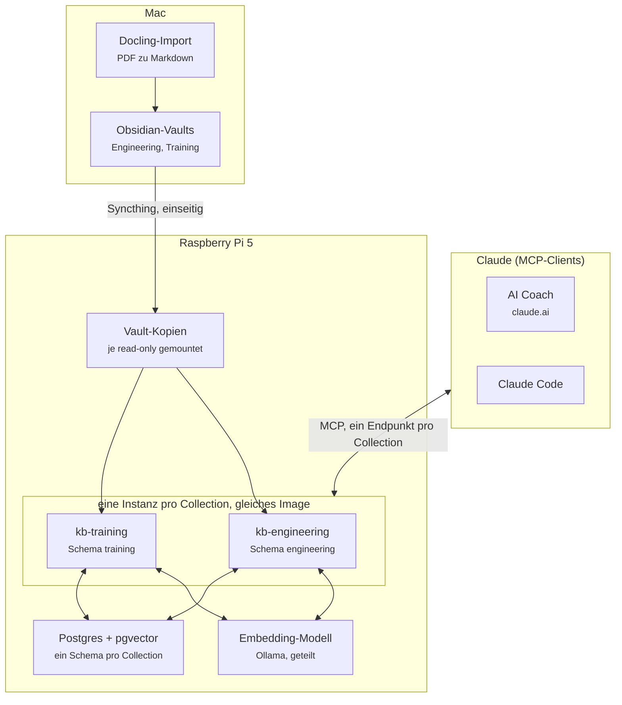
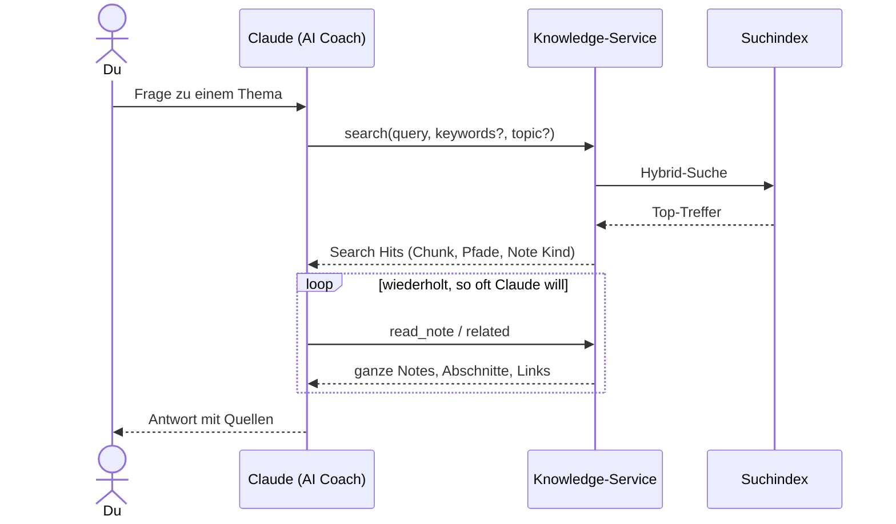
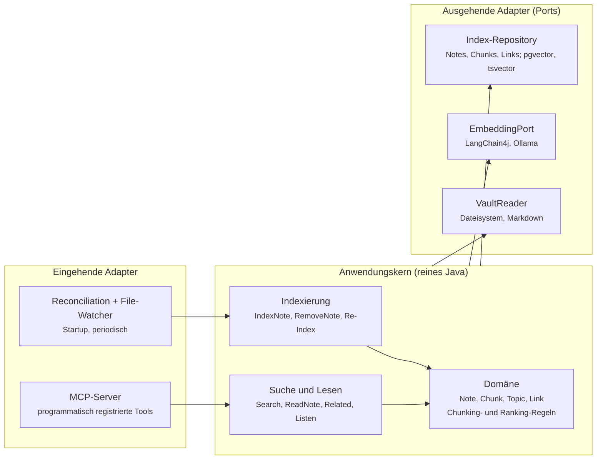

# Obsidian Knowledge-Service – Architekturübersicht

Begriffe stehen in [`GLOSSARY.md`](../GLOSSARY.md), Entscheidungen mit ihrer Begründung in [`docs/adr/`](adr/).

## Ziel und Leitprinzipien

Ein selbst betriebener Knowledge-Service auf dem Raspberry Pi 5 ersetzt den NotebookLM MCP: Claude (AI Coach, Claude Code) stellt Fragen zu einem Themengebiet und bekommt die passenden Stellen aus den eigenen Obsidian-Notes und Quellen – ohne Limits, vollständig selbst verwaltet.

1. **Obsidian ist die einzige Source of Truth.** Notes, PDFs und Verlinkungen leben in den Vaults auf dem Mac. Alles andere ist abgeleitet.
2. **Der Pi ist ein reines Read-Model.** Er empfängt die Vaults einseitig und baut daraus Suchindizes. Jeder Index ist jederzeit löschbar und neu aufbaubar; der Pi schreibt nie in einen Vault.
3. **Agentic RAG: Retrieval auf dem Pi, Generation durch Claude.** Der Service liefert nur Fakten (Chunks, Notes, Links). Claude entscheidet, wann und wie oft es sucht, liest und antwortet. Auf dem Pi läuft kein Sprachmodell, das Antworten formuliert.
4. **Schwere Arbeit dort, wo Rechenleistung ist.** PDF-Konvertierung mit Docling läuft auf dem Mac, nicht auf dem Pi.
5. **Modelle sind austauschbar.** Embedding-Modell (und später ein Re-Ranker) stecken hinter Ports und werden nur über Konfiguration gewählt. Ein Wechsel heisst: Konfiguration ändern, Index neu aufbauen, mit dem Evaluations-Set messen.
6. **Collections sind isoliert.** Engineering und Training sind getrennte Wissensbasen: eigener Vault, eigenes DB-Schema, eigene Service-Instanz mit eigenem MCP-Endpunkt. Ein Client sieht nur die Collections, deren Connector er hat. Geteilt wird nur Infrastruktur (Code, Postgres-Instanz, Ollama). Die Isolation dient der Relevanz und der Konfiguration pro Collection, nicht dem Zugriffsschutz.

## Systemübersicht



Der Mac ist Master: Syncthing spiegelt beide Vaults einseitig auf den Pi. Dort indexiert pro Collection eine eigene Service-Instanz ihren Vault in ihr eigenes Schema und liefert Claude per MCP nur Suchtreffer; die Antwort schreibt Claude selbst. Postgres und Ollama teilen sich beide Instanzen.

## Komponenten

| Komponente | Läuft auf | Verantwortung | Schreibt in den Vault? |
| --- | --- | --- | --- |
| Obsidian | Mac (Master) | Notes schreiben, Quellen verlinken, PDFs lesen | Ja (du) |
| Docling-Import | Mac | PDF aus `_inbox` → Markdown-Quellen-Note, PDF nach `_sources` verschieben | Ja |
| Syncthing | Mac (Send Only) → Pi (Receive Only) | Beide Vaults einseitig auf den Pi spiegeln, inkl. PDFs als Backup | Nein (nur Pi-Kopie) |
| Quarkus Knowledge-Service | Pi | Vault überwachen, Markdown parsen, chunken, embedden, Hybrid-Suche, MCP-Server; eine Instanz pro Collection | Nein |
| Postgres + pgvector | Pi | Chunks, Vektoren, Volltextindex, Link-Graph, Metadaten | – |
| Embedding-Modell | Pi (Ollama, Modell per Konfiguration austauschbar) | Text → Vektor für Chunks und Suchanfragen; multilingual (DE/EN) | – |
| Tailscale | Mac, Pi | Privater Netzzugang für Claude Code zum MCP-Endpunkt | – |
| Tunnel mit Auth | Pi | Öffentlich erreichbarer HTTPS-Endpunkt für Custom Connector in claude.ai (AI Coach) | – |
| Claude (AI Coach, Claude Code) | Anthropic / Mac | Tools aufrufen, Quellen lesen, Antwort mit Zitaten schreiben | Nein |

Der Pi hält damit zwei Dinge: eine Kopie aller Quellen (Vault inkl. PDFs) und den daraus abgeleiteten Index. Nur die Markdown-Dateien werden indexiert; PDFs liegen als Original daneben.

## Vault-Struktur und Konventionen

Es gibt zwei Collections, jede mit eigenem Vault. Regel: Was sich gegenseitig verlinken soll, liegt im selben Vault; Wikilinks funktionieren in Obsidian nicht über Vault-Grenzen.

| Collection | Vault | Themen | Inhalt |
| --- | --- | --- | --- |
| Engineering | `Engineering/` | Coaching, Software-Engineering | Coaching: nur die Quellen aus dem ASE-Coaching; Software-Engineering: allgemeine Fachquellen und eigene Notes |
| Training | `Training/` | Running, Cycling, Triathlon-Duathlon, Climbing, Bouldering, Physio | Trainingsquellen und eigene Notes |

Innerhalb eines Vaults ist der erste Ordner unterhalb des Vault-Roots das Topic; tiefere Ebenen erben es. Es kommt ausschliesslich aus dem Ordner, nie aus dem Frontmatter, und dient als optionaler Filter innerhalb der Collection. Notes direkt im Root werden indexiert, haben aber kein Topic; ein `topic`-Filter schliesst sie aus.

```
Engineering/                     ← Vault 1 → Collection "engineering"
├── Coaching/
│   ├── _inbox/                  ← PDFs hier ablegen (Docling holt sie ab)
│   ├── _sources/                ← Original-PDFs nach der Konvertierung
│   └── Quellen/                 ← von Docling erzeugte Quellen-Notes (.md)
└── Software-Engineering/
    ├── _inbox/  _sources/  Quellen/
    └── *.md                     ← eigene Notes, verlinken auf Quellen

Training/                        ← Vault 2 → Collection "training"
├── Running/
├── Cycling/
├── Triathlon-Duathlon/
├── Climbing/
├── Bouldering/
└── Physio/                      ← je _inbox/, _sources/, Quellen/, eigene Notes
```

Eine Quellen-Note bekommt Frontmatter, damit sie verlinkbar und filterbar ist:

```yaml
---
type: source
title: Clean Architecture – Kapitel 5
lang: en
source: "[[_sources/clean-architecture-ch5.pdf]]"
imported: 2026-11-05
published: 2017          # optional, von Hand: Jahr, Jahr-Monat oder Datum
author: Robert C. Martin # optional, für Zitate
tags: [architektur, dependency-rule]
---
```

- **Note Kind:** `type: source` macht eine Note zur Source Note, alles andere (auch ein fehlendes oder eigenes `type`) zur Own Note. Der Ordner `Quellen/` ist nur Ablage-Konvention; eine Note dort ohne `type: source` erzeugt eine Warnung, wird aber nicht korrigiert.
- **Title:** `title`, sonst der Dateiname ohne `.md`; die erste H1 wird nie verwendet.
- **Daten:** `imported` setzt der Importer; `published` ist optional. Fehlende Felder bleiben leer, ohne Rückfall auf die Dateizeit; ungültige Werte erzeugen eine Warnung.
- **Sprache:** `lang` erkennt der Importer, sonst gilt der Default der Collection; unbekannte Werte erzeugen eine Warnung.

Weitere Regeln:

- Eigene Notes verlinken mit Wikilinks auf Quellen-Notes; der Service liest diese Links als Graph (Links und Backlinks).
- Indexiert werden ausschliesslich `.md`-Dateien. Ordner mit `_`- oder `.`-Präfix werden auf jeder Ebene vollständig übersprungen, unabhängig vom Inhalt: `.obsidian/`, `.trash/`, `_inbox/`, `_sources/`, `_eval/`, `_templates/`.
- Ein neues Thema innerhalb einer Collection ist nur ein neuer Ordner. Eine neue Collection ist ein neuer Vault plus ein Konfigurationseintrag (eine weitere Service-Instanz).

## Abläufe

### PDF-Import (Mac)

1. PDF in `<Thema>/_inbox/` ablegen.
2. Das Import-Script ruft Docling auf und erzeugt Markdown mit Headings und Tabellen.
3. Es schreibt die Quellen-Note nach `<Thema>/Quellen/` mit `type`, `title`, `lang`, `imported` und `source` im Frontmatter (kein `topic`) und verschiebt das PDF nach `<Thema>/_sources/`.
4. Eine bestehende Quellen-Note wird nie überschrieben; bei Namensgleichheit bekommt die neue ein Suffix.
5. Scheitert Docling, wandert das PDF mit einem Log nach `<Thema>/_inbox/_failed/`.
6. Du verlinkst die Quelle aus deinen eigenen Notes.

Liefert Docling Markdown ohne brauchbare Headings, korrigiert der Importer nichts; die Grössengrenze des Splitters fängt das ab.

### Sync und Indexierung (Pi)

1. Syncthing überträgt geänderte Dateien vom Mac auf den Pi.
2. Jede Service-Instanz gleicht ihren Vault mit dem Index ab (Reconciliation): beim Start und alle N Minuten vergleicht sie Note-Pfade und Content-Hash und indexiert nur, was abweicht. Ein File-Watcher beschleunigt das auf Sekunden, ist aber nicht die Quelle der Korrektheit; ein Rename ist Delete plus Create.
3. Sie parst Frontmatter, Wikilinks und Headings und schneidet die Note in Chunks.
4. Sie berechnet die Embeddings und ersetzt in einer Transaktion alle Chunks, den Rohtext und die Links dieser Note.
5. Gelöschte Notes werden aus dem Index entfernt.

Beim Start vergleicht die Instanz zusätzlich den Index-Fingerprint (Embedding-Modell, Dimension, Chunking-Parameter) mit der Konfiguration. Weicht er ab, startet automatisch ein vollständiger Re-Index; bis er fertig ist, beantwortet die Collection keine Suchen und meldet den Fortschritt (x/y Notes) über Health und MCP-Fehlertext.

### Eine Frage des AI Coach



Claude entscheidet selbst, wie oft es sucht und welche Notes es ganz liest; der Service liefert nur Text, die Antwort entsteht in einem einzigen LLM-Call.

## Quarkus-Service intern



Die Domäne kennt weder Quarkus noch Postgres.

Der Service ist hexagonal geschnitten: Domäne und Use Cases sind reines Java, Quarkus, LangChain4j und Postgres stecken nur in den Adaptern. ArchUnit-Tests sichern die Abhängigkeitsrichtung ab, damit z.B. das Embedding-Modell oder der Vector Store austauschbar bleiben.

Die Collection ist reine Konfiguration (Name, Vault-Pfad, DB-Schema, MCP-Port, Tool-Beschreibung): dasselbe Image läuft einmal pro Collection. Im Code gibt es keine Fallunterscheidung zwischen Engineering und Training. Jede Instanz verbindet sich mit einer eigenen DB-Rolle, die nur ihr Schema sieht.

### MCP-Tools

| Tool | Parameter | Liefert |
| --- | --- | --- |
| `search` | `query`, `keywords?`, `topic?`, `k` | Search Hits: Chunk-Inhalt mit Note-Pfad, Heading-Pfad, Note Kind (`source`/`own`) und Score. Höchstens N Treffer pro Note (konfigurierbar, z.B. 2), mit Angabe, wie viele weitere Chunks der Note gepasst hätten. `keywords` steuert den Volltext, ohne sie wird `query` verwendet. Leer, wenn kein Vektor-Treffer die Minimum Similarity erreicht und der Volltext nichts findet |
| `read_note` | `path`, `heading?` | Die Note aus dem Index inkl. Frontmatter; lange Notes als Gliederung plus Anfang. `heading` ist ein Heading-Pfad wie im Search Hit; ein mehrdeutiger Pfad liefert alle passenden Abschnitte |
| `related` | `path` | Getrennte Kategorien: Links auf Notes, Backlinks, Links auf Dateien, unaufgelöste und mehrdeutige Links; Heading-Anker bleiben erhalten |
| `list_sources` | `topic` | Alle Source Notes eines Topics mit Title und Datum (`published`, sonst `imported`) |
| `list_topics` | – | Topics dieser Collection mit Anzahl Notes |

`path` ist ein Schlüssel im Index (vault-relativ, NFC-normalisiert, exakt gematcht), kein Dateipfad: Die Abfrageseite hat keinen Dateisystemzugriff, Pfad-Traversal ist durch Konstruktion ausgeschlossen, und Suche und Lesen sehen denselben Stand. Links werden als geschriebener Text gespeichert und erst bei der Abfrage wie in Obsidian aufgelöst ([ADR 0001](adr/0001-links-resolved-at-query-time.md)).

## Retrieval-Qualität

Die Suchqualität hängt an vier Stellschrauben; Chunking und Hybrid-Suche bringen meist mehr als ein grösseres Embedding-Modell, weil sie ganze Fehlerklassen beheben statt nur die Ähnlichkeit zu verfeinern.

### 1. Chunking: eigener Markdown-Splitter

Das Markdown wird als Syntaxbaum geparst (z.B. commonmark-java oder flexmark); der Splitter ist Domänenlogik:

- Ein Chunk pro H2/H3-Abschnitt (Ebene konfigurierbar).
- Grenzen in Zeichen, modellunabhängig (Richtwert ca. 200 / 2000): kleinere Abschnitte mit dem Nachbarn zusammenlegen, grössere nach Absätzen teilen, mit leichter Überlappung. Kein Tokenizer im Service; ein Modellvergleich ändert so nur das Modell, nicht die Chunks. Die Obergrenze liegt inklusive Kontext-Präfix weit unter dem Eingabelimit aller Kandidatenmodelle.
- Nie mitten in Codeblöcken oder Tabellen schneiden; solche atomaren Blöcke dürfen die Obergrenze überschreiten.
- Wikilinks für das Embedding bereinigen (`[[Clean Architecture|CA]]` → "CA"); der Link selbst wird als geschriebener Text gespeichert.
- Frontmatter nicht einbetten, sondern als Metadaten speichern (`tags`, Note Kind, Title, Sprache); der Rohtext der ganzen Note wird für `read_note` gespeichert.
- `ChunkId` = Note-Pfad plus laufende Nummer: eindeutig auch bei doppelten Headings und geteilten Abschnitten, bewusst nicht stabil über Änderungen. Die Einheit des Ersetzens ist die Note; der Heading-Pfad bleibt als Attribut für Embedding-Kontext und Zitate.
- Geänderte Chunking-Parameter erfordern einen vollständigen Re-Index und werden als eigenes Experiment gemessen.

Der wichtigste Hebel ist die Trennung von Embedding-Text und Anzeige-Text: eingebettet wird der Text mit vorangestelltem Kontext, an Claude zurückgegeben nur der Inhalt plus Pfad.

```java
public record Chunk(ChunkId id, NotePath note, HeadingPath headings, String content) {

    /** Text für das Embedding: mit Kontext, damit der Vektor weiss, worum es geht. */
    public String embeddingText(Topic topic, NoteTitle title) {
        return "%s > %s > %s%n%n%s".formatted(topic, title, headings, content);
    }
}
```

### 2. Hybrid-Suche: zwei Ranglisten, eine Fusion

Vektorsuche findet Bedeutung, Volltext findet exakte Begriffe (Klassennamen, Abkürzungen, Eigennamen). Die Vektorsuche nutzt `query` und sucht sprachübergreifend; der Volltext nutzt `keywords` (sonst `query`) mit UND-Verknüpfung und ist nur für exakte Begriffe da. Volltext-Treffer kommen ungefiltert durch, Vektor-Treffer nur über der Minimum Similarity. Beide Ranglisten werden per Reciprocal Rank Fusion zusammengeführt:

```sql
WITH vec AS (
  SELECT id, row_number() OVER (ORDER BY embedding <=> :queryVector) AS rank
  FROM chunk
  WHERE (:topic IS NULL OR topic = :topic)
  ORDER BY embedding <=> :queryVector
  LIMIT 50
),
fts AS (
  SELECT id, row_number() OVER (ORDER BY ts_rank_cd(tsv, q) DESC) AS rank
  FROM chunk, websearch_to_tsquery('simple', :queryText) q
  WHERE tsv @@ q AND (:topic IS NULL OR topic = :topic)
  ORDER BY ts_rank_cd(tsv, q) DESC
  LIMIT 50
)
SELECT id, sum(1.0 / (60 + rank)) AS score
FROM (SELECT * FROM vec UNION ALL SELECT * FROM fts) ranked
GROUP BY id
ORDER BY score DESC
LIMIT :k;
```

| Stellschraube | Wirkung |
| --- | --- |
| Kandidaten pro Liste, finales `k` | Breite der Suche vs. Rauschen |
| Minimum Similarity (Cosine, auf der Vektorliste vor der Fusion) | Unter dem Schwellwert zählt ein Vektor-Treffer nicht; verhindert themenfremde Antworten. RRF bestimmt danach nur die Reihenfolge, ein Schwellwert auf dem RRF-Score wäre wirkungslos ([ADR 0002](adr/0002-minimum-similarity-before-fusion.md)). Der Wert gehört zum Modell und wird pro Collection mit Negativ-Fragen kalibriert |
| Treffer pro Note | Verhindert, dass eine lange Note alle Plätze belegt |
| `setweight` auf Titel und Headings | Treffer in Überschriften zählen mehr als im Fliesstext |
| Sprache pro Note, `to_tsvector(lang::regconfig, …)` | Stemming und Stoppwörter für Deutsch und Englisch statt `'simple'`. Die Anfrage wird mit jeder Sprache der Collection zerlegt, jeder Chunk mit der tsquery seiner Sprache verglichen |
| Re-Ranker auf die Top 30 (später) | Präzisere Reihenfolge, kostet Rechenzeit auf dem Pi |

Alle Werte kommen aus der MicroProfile Config: ein Experiment ist eine Konfigurationsänderung, kein Code-Change.

### 3. Messen: Evaluations-Set als Test

Eine Datei mit echten Fragen und den erwarteten Notes:

```yaml
- question: "Was besagt die Dependency Rule?"
  topic: Software-Engineering
  expected: [Software-Engineering/Quellen/clean-architecture-ch5.md]
```

Der Test berechnet drei Kennzahlen, gezählt auf Notes im tatsächlich zurückgegebenen Ergebnis (nicht auf einer nachträglich deduplizierten Liste):

- **Hit@5** (Hauptkennzahl): mindestens eine erwartete Note unter den Top 5, weil Claude von einem guten Einstieg aus weiterliest.
- **Recall@5**: Anteil der erwarteten Notes unter den Top 5; misst die Abdeckung breiter Fragen.
- **MRR**: Rang der ersten erwarteten Note.

Start mit einer Baseline (reine Vektorsuche, feste Chunks), dann immer genau eine Stellschraube ändern und erneut messen. Experimente laufen lokal auf dem Mac (Dev Services, Ollama mit demselben Modellnamen, lokaler Vault); ein Lauf auf dem Pi bestätigt nur die finale Konfiguration, weil Ollama auf ARM und x86 leicht andere Vektoren liefern kann.

Jede Collection hat ihr eigenes Evaluations-Set. Dazu kommen Negativ-Fragen, z.B. eine Trainingsfrage gegen die Engineering-Collection. Eine Negativ-Frage besteht, wenn kein Vektor-Treffer die Minimum Similarity erreicht; Volltext-Treffer werden getrennt und nur zur Information gemeldet. So zeigt sich, ob der Volltext in der Praxis Rauschen bringt.

### 4. Tool-Beschreibungen

Claude formuliert die Suchanfragen selbst; die `@Tool`-Beschreibungen steuern, wie gründlich es sucht:

```java
@Tool(description = """
    Durchsucht Lucas Engineering-Wissensbasis (Obsidian).
    'query' ist die Frage in eigenen Worten (Vektorsuche, sprachübergreifend).
    'keywords' sind optionale exakte Begriffe für den Volltext
    (Klassennamen, Abkürzungen, Eigennamen).
    Setze 'topic', wenn das Themengebiet klar ist (siehe list_topics).
    Lies vielversprechende Treffer danach mit read_note (optional 'heading'),
    bevor du antwortest, und zitiere den Note-Pfad.""")
SearchResult search(String query, Optional<String> keywords, Optional<String> topic, int k) { … }
```

Da sich die Instanzen nur in dieser Beschreibung unterscheiden ("Engineering-Wissensbasis …" vs. "Trainings-Wissensbasis …"), kommt der Text pro Collection aus der Konfiguration. Annotationswerte müssen Konstanten sein; dafür eignet sich die programmatische Tool-Registrierung der MCP-Extension.

## Technologie-Stack

| Bereich | Wahl | Begründung |
| --- | --- | --- |
| Sprache / Framework | Java 21+, Quarkus (JVM-Modus) | Beruflich relevanter Stack; CDI-Modell nah an Jakarta EE/MicroProfile |
| AI-Bausteine | Quarkus LangChain4j (Embedding-Modell, Embedding-Store, Splitter) | Fertige Bausteine, aber eigene Ingestion statt Easy RAG |
| MCP | `quarkus-mcp-server-http` (Streamable HTTP) | Remote-Zugriff vom Mac und von claude.ai |
| Datenbank | Postgres + pgvector (ein Schema pro Collection), Volltext via `tsvector` | Vektor- und Keyword-Suche in einer DB, Hybrid via Reciprocal Rank Fusion |
| Embeddings | Default `bge-m3` (1024 Dim.); Kandidat `Qwen3-Embedding-0.6B` | Stark multilingual (DE/EN), läuft auf der Pi-CPU; Wahl per Konfiguration, entschieden per Evaluation |
| Modell-Runtime | Ollama auf dem Pi | Modell per Name austauschbar, kein Code-Change |
| PDF-Konvertierung | Docling als Python-Bibliothek im Importer auf dem Mac | Apple Silicon ist um ein Vielfaches schneller als die Pi-CPU |
| Sync | Syncthing (Send Only / Receive Only) | Einseitig, Pi kann den Vault nicht verändern |
| Betrieb | Docker Compose auf dem Pi, NVMe-SSD | SD-Karten verschleissen unter Postgres-Last |

**Ressourcen (Pi 5, 8 GB RAM):** OS ca. 0.5 GB, Postgres ca. 0.5–1 GB, zwei Quarkus-Instanzen mit begrenztem Heap je ca. 0.4–0.6 GB, Ollama mit bge-m3 ca. 1–1.5 GB. Zusammen rund 3.5–4.5 GB, also weiterhin genug Reserve für Re-Indexierung und einen späteren Re-Ranker. Postgres und Ollama werden von beiden Collections geteilt.

**Austauschbare Modelle:** Der `EmbeddingPort` kennt nur "Text rein, Vektor raus". Modellname und Vektor-Dimension kommen aus der Konfiguration; jeder Chunk speichert, mit welchem Modell er erzeugt wurde. Ein Modellwechsel erzwingt so einen vollständigen Re-Index, nie einen gemischten Index. Das Embedding bleibt auf dem Pi, weil auch jede Suchanfrage im Moment der Frage mit demselben Modell eingebettet werden muss.

**Lizenzen:** Quarkus, LangChain4j, quarkus-mcp-server (Apache 2.0), Postgres und pgvector (PostgreSQL License), Docling und Ollama (MIT), Syncthing (MPL 2.0) und die Embedding-Modelle sind Open Source. Obsidian ist gratis, aber proprietär; ohne Lock-in, weil der Vault aus reinen Markdown-Dateien besteht. Tailscale ist teilweise offen (voll offen: Headscale).

## Repository

Das ganze System liegt in einem Repo, **`obsidian-knowledge-mcp`**, auch wenn es auf zwei Maschinen läuft. So sind Service, Import-Script, Deployment und Evaluation gemeinsam versioniert.

```
obsidian-knowledge-mcp/
├── service/              ← Quarkus Knowledge-Service (Maven-Modul)
│   ├── src/main/java/…   ← domain, application, adapter (hexagonal)
│   └── src/test/java/…   ← Unit-, ArchUnit-, Integrations- und Evaluationstests
├── importer/             ← Docling-Import für den Mac (Python-Projekt mit uv + launchd-Template)
├── deploy/               ← docker-compose.yml, .env.example, Konfiguration pro Collection
├── docs/                 ← Architektur, ADRs
├── .github/workflows/    ← Build, Tests, arm64-Image nach GHCR
├── README.md
└── LICENSE
```

- **Nie im Repo:** Vault-Inhalte, `.env` mit Tokens und Passwörtern, persönliche Evaluations-Fragen. Die Evaluations-Sets liegen pro Collection im jeweiligen Vault (z.B. `Engineering/_eval/questions.yaml`) und werden dem Test per Pfad übergeben.
- **Image-Tag:** ein Image für alle Collections; welche Collection eine Instanz bedient, entscheidet nur die Konfiguration in `deploy/`.

## Tooling und Betrieb

Auf dem Mac laufen vier Tools plus ein Import-Script, auf dem Pi vier Container in einer Compose-Datei (zwei Service-Instanzen, Postgres, Ollama) plus drei native Dienste.

### Mac

| Tool | Zweck | Installation |
| --- | --- | --- |
| Obsidian | Beide Vaults bearbeiten, Quellen verlinken | App |
| Docling | PDF → Markdown | Bibliothek im Importer-Projekt (uv), Version gepinnt, OCR an; Modelle vorab mit `docling-tools models download` |
| Import-Script | `_inbox`-Ordner beider Vaults überwachen, Docling aufrufen, Quellen-Note mit Frontmatter schreiben, PDF nach `_sources` verschieben | Python-Projekt (uv) im Repo, gestartet per `launchd` im Minutentakt; prüft die `_inbox/` aller Topics beider Vaults (Polling statt WatchPaths, das nicht rekursiv ist) |
| Syncthing | Beide Vaults einseitig zum Pi senden (Send Only) | App oder `brew` |
| Tailscale | Privates Netz zum Pi | App |
| Claude Code | MCP-Client mit zwei Connectors, z.B. `http://<pi>.<tailnet>:8081/mcp` (Engineering) und `:8082/mcp` (Training) | vorhanden |

Docker braucht es auf dem Mac nur für die Entwicklung; Quarkus Dev Services starten dort Postgres mit pgvector automatisch.

### Raspberry Pi 5

| Tool | Zweck | Betrieb |
| --- | --- | --- |
| Raspberry Pi OS Lite (64-bit) | Basis ohne Desktop | auf NVMe-SSD |
| `kb-engineering` | Quarkus-App für die Collection Engineering: Indexierung, Suche, MCP | Container (eigenes arm64-Image), Schema `engineering` |
| `kb-training` | Dieselbe Quarkus-App für die Collection Training | Container (gleiches Image, andere Konfiguration), Schema `training` |
| `postgres` | Chunks, Vektoren, Volltext, Links; ein Schema pro Collection | Container (`pgvector/pgvector`) |
| `ollama` | Embedding-Modell (bge-m3), von beiden Instanzen genutzt | Container (offizielles Image) |
| Syncthing | Beide Vaults empfangen (Receive Only) | nativ (apt); jeder Vault als read-only Volume nur in seinen Container |
| Tailscale | Zugriff vom Mac | nativ (apt) |
| Tunnel | Öffentliche HTTPS-Endpunkte für claude.ai | nativ: Tailscale Funnel |

Syncthing und Tailscale laufen nativ, weil sie eng mit Netzwerk und Dateisystem des Hosts arbeiten.

### Betrieb

- **Build und Deployment:** Git-Repo + GitHub Actions bauen ein arm64-Image (Jib oder `docker buildx`) und pushen es in die GitHub Container Registry; auf dem Pi `docker compose pull && docker compose up -d`.
- **Health:** `quarkus-smallrye-health` liefert Healthchecks für Compose.
- **Re-Index:** startet automatisch, wenn der Index-Fingerprint (Modell, Dimension, Chunking-Parameter) nicht zur Konfiguration passt; ein Admin-Endpunkt erzwingt ihn bei Bedarf. Währenddessen beantwortet die Collection keine Suchen.
- **Backup:** Vault liegt auf Mac und Pi, dazu Time Machine. Die Datenbank wird nicht gesichert, weil der Index jederzeit aus dem Vault neu aufgebaut werden kann.
- **Sicherheit:** Jeder Client bekommt pro Collection ein eigenes statisches Bearer-Token (claude.ai, Claude Code), das Quarkus prüft; claude.ai Custom Connectors senden es als Request-Header. Die Tokens liegen in `.env`; ein einzelner Client lässt sich so sperren, ohne die anderen anzufassen. Rotieren heisst: Connector entfernen und neu anlegen, weil sich Auth-Einstellungen danach nicht mehr ändern lassen. Der öffentliche Endpunkt läuft über Tailscale Funnel.

## Entscheidungen, Trade-offs und nächste Schritte

| Entscheidung | Statt | Trade-off |
| --- | --- | --- |
| Eigener Quarkus-Service | RAGFlow | Mehr Eigenbau; dafür Obsidian bleibt Master, läuft leicht auf dem Pi, Java-Lerneffekt |
| Retrieval-only MCP (Agentic RAG) | Server ruft selbst ein LLM auf | Qualität hängt am Client-Modell; dafür ein LLM-Call statt zwei, Claude sieht die Originalquellen |
| Vault-Master auf dem Mac, Sync einseitig | Pi als Master | Pi ist nur so aktuell wie der letzte Sync (Mac muss laufen) |
| Docling auf dem Mac | docling-serve auf dem Pi | Import nur am Mac möglich; dafür schnell und Pi bleibt schlank |
| Zwei Collections: eigener Vault, eigenes Schema, eigene Instanz | Ein Index mit `topic`-Filter | Etwas mehr RAM (zweite JVM) und keine Links zwischen Engineering und Training; dafür echte Isolation und Konfiguration pro Collection (Sprache, Chunking, Modell) |
| Ein Schema pro Collection in einer Postgres-Instanz, eigene DB-Rolle pro Instanz | Eigene DB-Instanz pro Collection | Gemeinsamer Betrieb; Isolation auf Schema-Ebene reicht für diesen Zweck |
| Links als Text speichern, bei der Abfrage auflösen (ADR 0001) | Aufgelöster Graph beim Indexieren | Etwas teurere Abfrage; dafür bleibt das Ersetzen auf eine Note begrenzt, Backlinks stimmen auch nach Anlegen oder Umbenennen |
| Minimum Similarity vor der Fusion (ADR 0002) | Mindest-Score auf dem RRF-Score | Schwellwert ist modellabhängig und muss nach jedem Modellwechsel neu kalibriert werden; dafür trennt er überhaupt passend von unpassend |
| Reconciliation als Quelle der Korrektheit | Nur File-Watcher | Periodischer Abgleich kostet etwas CPU; dafür keine verpassten Änderungen nach Deploy oder Neustart |
| `read_note` aus dem Index | Lesen aus dem Dateisystem | Rohtext liegt doppelt; dafür kein Pfad-Traversal und derselbe Stand wie die Suche |
| Re-Index schaltet die Suche ab | Alten Index bis zum Umschalten weiterbetreiben | Stunden ohne Suche nach einem Modellwechsel; dafür kein doppelter Speicher und keine Umschaltlogik |
| Statisches Bearer-Token pro Client | OAuth-Server, Cloudflare Access | Rotieren heisst Connector neu anlegen; dafür kein zusätzlicher Dienst |

### Offene Punkte

- [x] RAM des Pi 5 klären: 8 GB, reicht für das Setup
- [x] Collections festlegen: Engineering (Coaching, Software-Engineering) und Training
- [ ] bge-m3 gegen Qwen3-Embedding-0.6B auf eigenen deutschen und englischen Notes vergleichen
- [ ] Minimum Similarity pro Collection und Modell mit Negativ-Fragen kalibrieren (Verfahren entschieden, Werte offen)
- [x] Authentifizierung und Tunnel: Bearer-Token pro Client über Tailscale Funnel
- [x] Chunking-Strategie: Heading-Splitting plus Grenzen in Zeichen, atomare Blöcke ungeteilt

### Nächste Schritte

1. Zwei Vaults anlegen (Engineering, Training), Syncthing Mac → Pi für beide einrichten.
2. Docling-Import-Script auf dem Mac (`_inbox` → `Quellen/` + `_sources/`).
3. Walking Skeleton auf dem Pi, zuerst nur für Engineering: Quarkus + pgvector + Tool `search` (nur Vektor), in Claude Code einbinden.
4. Evaluations-Set: 15–20 echte Fragen plus Negativ-Fragen, Antworten gegen NotebookLM vergleichen.
5. Hybrid-Suche, Minimum Similarity, Reconciliation, `read_note`, `related`, `list_sources` ergänzen und erneut messen.
6. Zweite Instanz für Training aus demselben Image starten (nur Konfiguration).
7. Zugriff für den AI Coach in claude.ai freischalten; NotebookLM für "ask" ablösen, sobald die Evaluation gleichwertig ist.
